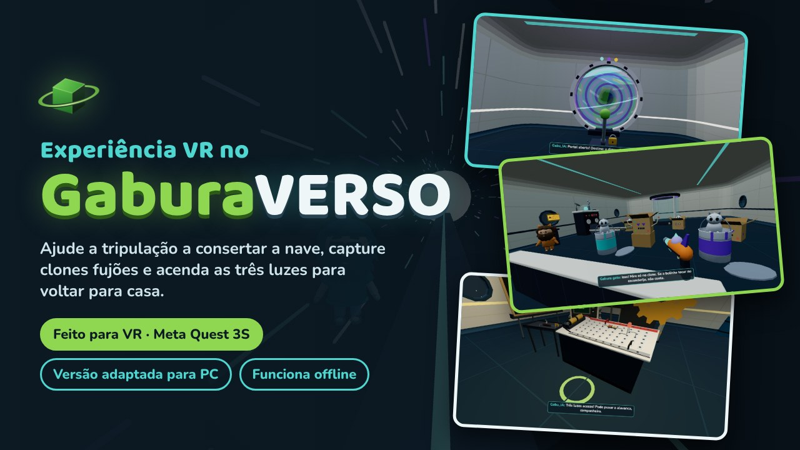
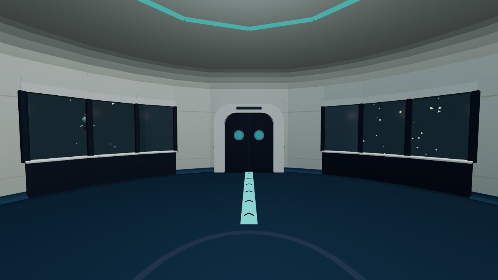
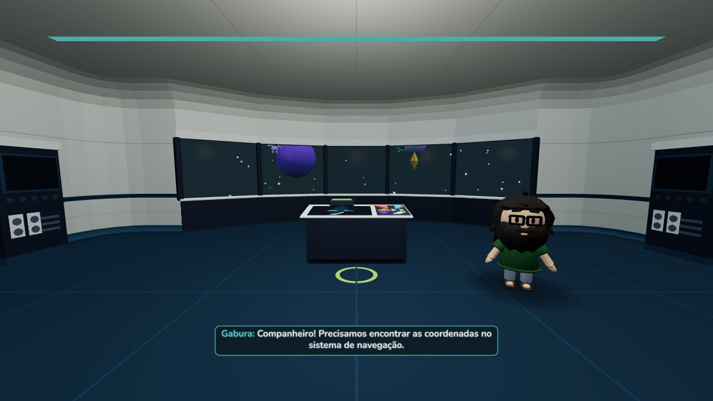
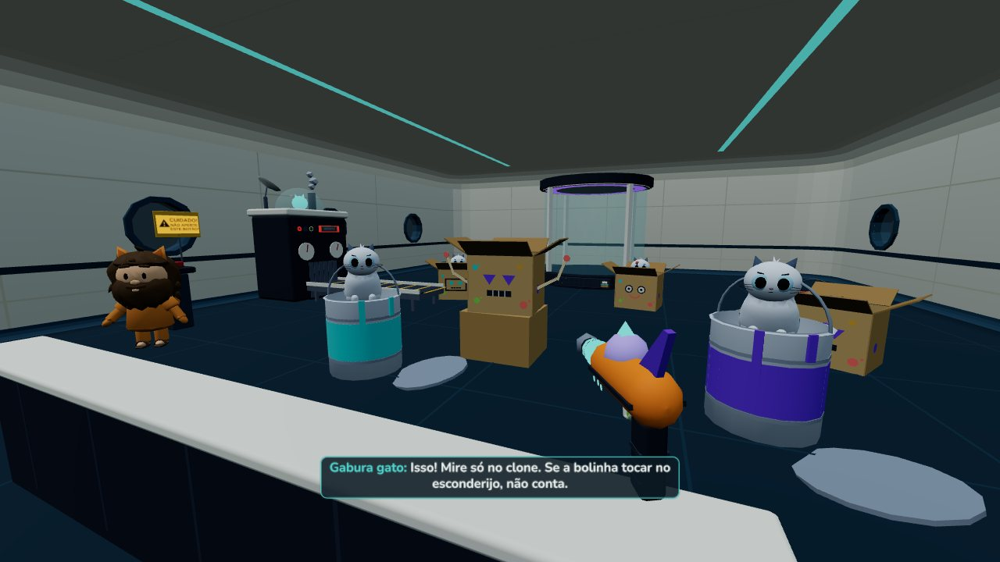
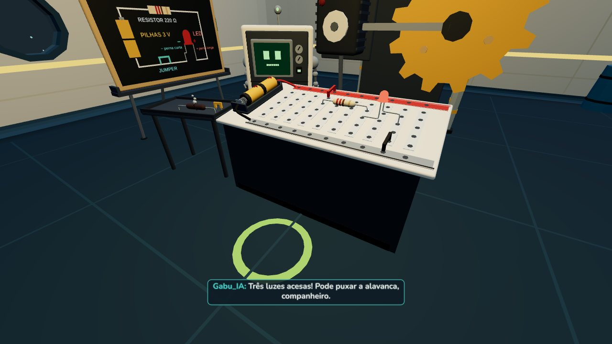
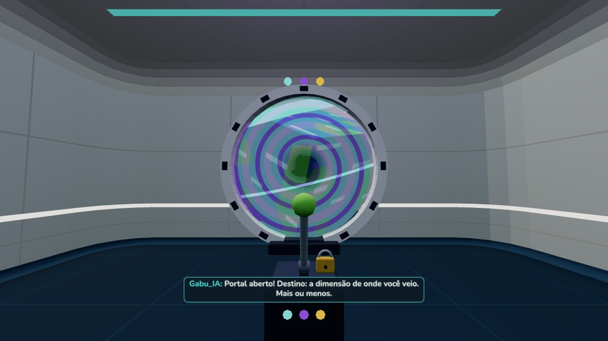
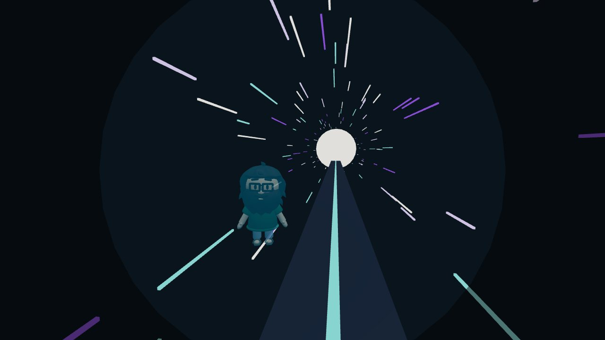

# Experiência VR no GaburaVERSO



**Jogue:** https://gaburadigital.github.io/jogo-xp-vr-gaburaverso/


> O Quest 3S não lê QR codes sozinho: o QR serve para abrir o link no celular ou com um app leitor de QR da loja do Quest. No óculos, o mais rápido é digitar o link no navegador.

## Sobre o jogo

Você acorda a bordo da nave do **Gaburaverso**, e ela está meio apagada. O relógio no seu pulso vibra: é a **Gabu_IA**, a assistente da nave, chamando para uma missão. Para voltar para casa, é preciso religar as **três luzes** da nave, uma em cada sala, ajudando a tripulação mais atrapalhada do universo:

- na **Ponte**, o Gabura perdeu as coordenadas: encontre o cyberdeck e monte o foguete do tangram no console de navegação;
- no **Treinamento**, a máquina de clonagem do Gabura gato pegou fogo e espalhou clones do Gojo e do Fred pela sala: pegue a arma de captura laser e acerte só os clones;
- na **Oficina**, o MetalgabuTRON precisa de mãos (e não garras): monte um circuito de verdade na protoboard e acenda o LED.

Com as três luzes acesas, o portal da nave se abre. Puxe a alavanca, atravesse e faça a viagem de volta pelo túnel de hiperespaço enquanto os amigos se despedem.

| | |
|---|---|
| **Gênero** | aventura e quebra-cabeça em primeira pessoa |
| **Duração** | de 15 a 20 minutos |
| **Público** | de 11 a 22 anos (feito pensando nos meus alunos) |
| **Idioma** | português do Brasil, com vozes e legendas |
| **Missões** | em qualquer ordem, com o progresso salvo no navegador |
| **Internet** | só na primeira visita: depois o jogo funciona **offline** |

> **Feito para VR.** A experiência foi pensada para o **Meta Quest 3S**: pegar as peças com as mãos, levantar o pulso para ver o relógio, mirar com a arma e encaixar componentes na protoboard. Outros óculos com navegador compatível com WebXR devem funcionar, mas o jogo foi testado no Quest 3S.
>
> **Versão adaptada para PC.** Quem não tem o óculos pode jogar no computador (teclado e mouse), num navegador atual (testado no Chrome). Algumas ações foram adaptadas (por exemplo, a câmera de foco para montar o tangram e o circuito), então a sensação não é a mesma do VR.

### Telas do jogo

| | |
|---|---|
|  |  |
| Sala central | Ponte: o tangram de navegação |
|  |  |
| Treinamento: a caça aos clones | Oficina: o circuito do LED |
|  |  |
| O portal aberto | A viagem pelo túnel |

*Capturas da versão para PC. No óculos, o jogo é visto em 3D e com as mãos.*

## Primeira visita no Quest

1. Abra o link no navegador do Quest.
2. Toque em **Salvar para jogar sem internet** e espere chegar a 100%. Depois disso o jogo abre mesmo sem Wi-Fi.
3. Instale como app (menu do navegador → *Instalar app*) ou adicione aos favoritos.
4. Toque em **Jogar no VR**. Nas próximas vezes, o Quest já mostra só esse botão (o resto fica em **Mais opções**).

**Verificar atualização** (na tela inicial) procura a versão nova quando houver internet.

## Controles

| Meta Quest | | Computador | |
|---|---|---|---|
| Analógico esquerdo | andar | W A S D | andar |
| Analógico direito | girar (em passos ou contínuo, nas Opções) | Mouse | olhar |
| Grip (lateral) | segurar / soltar | Clique direito | segurar / soltar |
| Gatilho | usar, apertar, atirar, girar a peça 45° | Clique esquerdo | usar, apertar, atirar |
| X ou levantar o pulso | relógio | R | relógio |
| Y | menu (pausa) | Esc | menu (pausa) |
| A | virar a peça do tangram ou o LED | E, roda ou clique direito | girar a peça do tangram |
| | | F | virar a peça do tangram ou o LED |
| | | Espaço | pular a fala |

O botão ≡ do controle esquerdo não chega ao navegador no WebXR; por isso o menu abre no **Y**.

## O que tem no jogo

- Tela inicial, aviso da versão PC, menu de pausa, Opções (Música, Efeitos, Vozes, giro, conforto, altura, iluminação, legendas), Como jogar e Missão.
- **Abertura** completa na sala central: relógio vibrando, janela com o título, caixas para pegar, jogar, empurrar e empilhar.
- Depois da abertura, as três missões **em qualquer ordem** (cada uma começa ao entrar na sala dela):
  - **Ponte**: achar o cyberdeck, encaixar no console e montar o foguete do tangram (no VR a peça vem na mão; solta fora da mesa, volta para o lugar).
  - **Treinamento**: a máquina de clonagem cospe 8 Gojos e 8 Freds, que se escondem. Do posto (só dá para andar para os lados), pegue a arma de captura laser e atire só no clone: acertar o esconderijo não conta. Soltou a arma ou saiu da sala, ela volta para o suporte.
  - **Oficina**: montar o circuito na protoboard (jumper vermelho, resistor, LED com a perna longa no +, jumper preto). O resistor queimado e o jumper curto não encaixam; o LED ao contrário não acende (vire com A ou F).
- Portas com botão: o botão abre e fecha; do lado de dentro elas abrem sozinhas e fecham quando você volta para a sala central.
- Cada missão acende a luz da sala, a do painel, a faixa do chão e o LED do relógio.
- **Final:** com as 3 luzes acesas, a faixa do chão leva à câmara do portal. Puxe a alavanca, atravesse o portal e faça a viagem pelo túnel de hiperespaço enquanto os amigos se despedem. Depois vêm os créditos, com a foto do autor com os alunos.
- O progresso fica salvo no navegador. Com jogo salvo, a tela inicial oferece **Continuar de onde parou** ou **Jogar do início**; no menu de pausa há **Reiniciar missão** e **Recomeçar jogo** (com confirmação).
- Mãos: luvas de blocos (gatilho dobra o indicador, grip fecha a mão) com o relógio da Gabu_IA no pulso esquerdo. Vibradinhas sutis ao chegar perto de algo, segurar, encaixar e tocar nos personagens; forte só no tiro.

## Desenvolvimento

```bash
npm install
npm run dev      # http://localhost:5173/jogo-xp-vr-gaburaverso/
npm run build    # gera dist/ (o GitHub Pages publica sozinho pela Action)
```

**Testar no Quest pelo cabo:** ligue o modo desenvolvedor do Quest, conecte o USB e abra `chrome://inspect` no Chrome do computador para ver o console do navegador do óculos.

**Publicar:** commit e push pelo GitHub Desktop → aguarde a Action (aba *Actions*) → no Quest, **Verificar atualização**. No GitHub: *Settings → Pages → Source: GitHub Actions*.

### Mapa do código (`src/`)

| Pasta | O que tem |
|---|---|
| `nucleo/` | dados (pacote de cenas e falas), áudio (Músicas, Efeitos, Vozes), opções e progresso |
| `mundo/` | Three.js: renderizador com WebXR, modelos, holograma, boca pela voz, paredes, luzes |
| `cenas/` | o tocador de cenas (igual ao Editor de Cenas) e o diretor, que liga as cenas ao jogo |
| `xr/` | entrada (VR e PC viram as mesmas ações) e o jogador (andar, girar, relógio) |
| `interacao/` | objetos que dá para pegar e as portas |
| `missoes/` | abertura, ponte, treinamento, oficina, portal e túnel, e os efeitos que ficam no mundo (faixas, luzes) |
| `interface/` | tela inicial, painéis do VR, legenda e os desenhos em SVG |

As cenas vêm do **Editor de Cenas Gabura** (`public/dados/cenas_nave.json`): falas, movimentos, sons, eventos e os "aguardar" (o jogo segue quando o jogador faz o que a cena pede).

### Testes automáticos

`python3 testes/rodar_todos.py` monta o jogo, liga o servidor, roda todos os testes no Chrome sem janela e **desliga o servidor no fim** (veja `testes/LEIA.md`). As fotos de divulgação saem de `testes/fotos_divulgacao.py`; a thumb, de `fontes_de_arte/thumb/gerar_thumb.py` (gera `docs/thumb.jpg`, 1280×720, e `docs/capa_630x500.jpg`, no tamanho de capa do itch.io).

## Licença

O **código** está sob a licença MIT (veja `LICENSE`): pode estudar, copiar e mudar. A marca Gaburaverso, os personagens, os textos do roteiro, as vozes e a identidade visual são **reservados** à Gabura Digital e não entram na MIT. Fontes Baloo 2 e Nunito: SIL Open Font License 1.1. Feito com Vite, TypeScript e Three.js 0.170.
